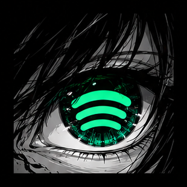
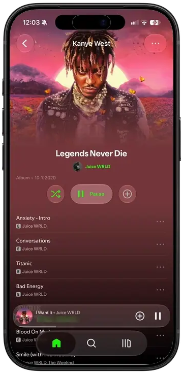
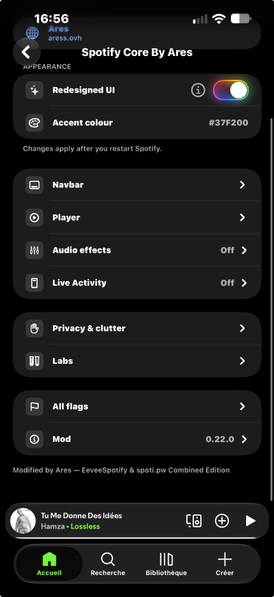
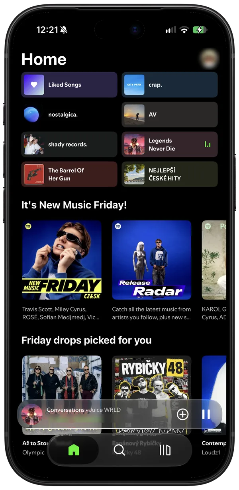
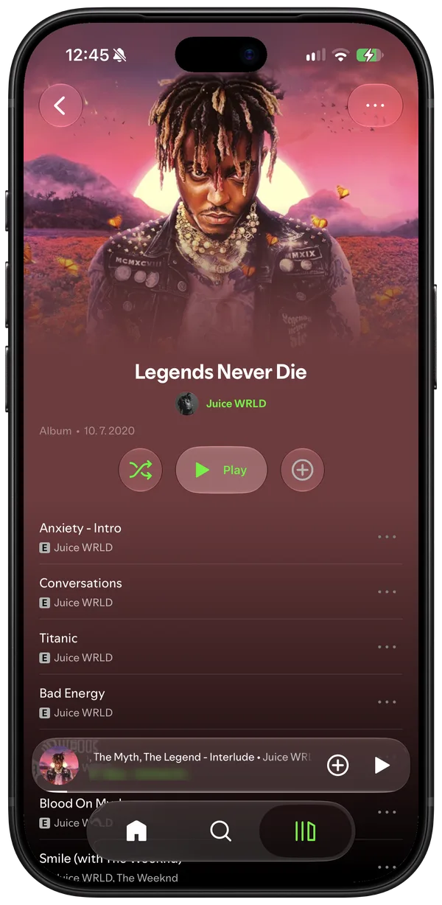
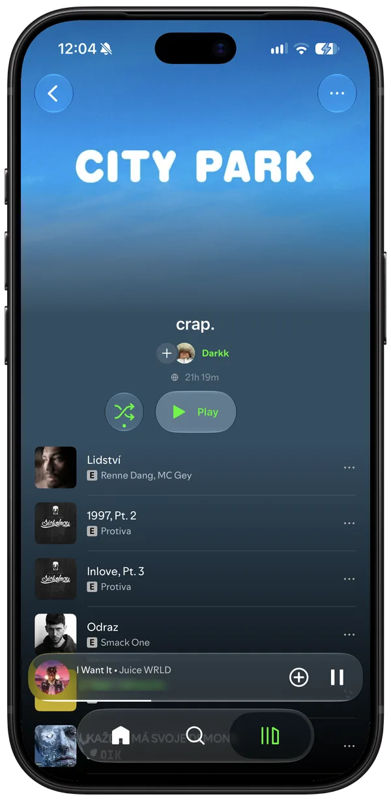
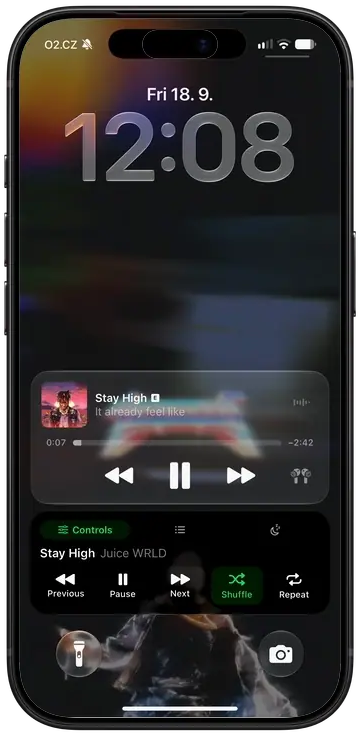

  

<h1 align="center">Spotify Core</h1>

  <b>Modified by Ares · Built on Spotify 9.1.90</b> 
  Liquid Glass UI (iOS 26+) &amp; Legacy UI (iOS 16.1+) with built-in Spotify Premium features, synced lyrics &amp; Sing mode, offline downloads, Audio DSP, AutoMix, Live Activity, and Safari link opener.

  
  
  

  <a href="#-previews">Screenshots</a> •
  <a href="#-whats-inside">What's Inside</a> •
  <a href="#-download">Download</a> •
  <a href="#-installation">Installation</a> •
  <a href="#-creator">Creator</a>

---

## 🎬 Motion Teaser

  <a href="assets/spotify_core_presentation_1080p.mp4">
    
     
    ▶ Click to watch the official 1080p Motion Design presentation (MP4)
  </a>

---

## 📸 Previews

  
  
  

  
  
  

---

## ⚡ What's Inside

Spotify Core v0.60.14 (**Modified by Ares**), built on **Spotify 9.1.90**:

* **20 Custom App Icons (Appearance → App icon)** — Choose from 20 custom Spotify Core icons (all iPhone & iPad system sizes, iOS 16.1+ and iOS 26+) plus 8 Liquid Glass icons on iOS 26+, applied across iOS and preserved across updates.

* **Liquid Glass UI (iOS 26+) & Legacy UI (iOS 16.1+)** — Redesigned `UIGlassEffect` experience on iOS 26+ alongside full Legacy UI support on iOS 16.1+, configurable in **Spotify Core settings** (with automatic restart prompt when needed).
* **Built-in Premium & Ad-Blocking** — Ad-free listening (`Premium: Lifetime`), True Shuffle, unlimited on-demand skips, highest streaming quality, upsell suppression, clean shared links, rating prompt blocking, and telemetry blocking.
* **Synced Lyrics, Translation & Karaoke (Sing)** — Word-synced lyrics, live translation, and vocal/instrumental separation in Sing mode.
* **Offline Downloads (Spotify 9.1.90)** — Verified offline download support, quota and device slot inspection, and download management inside **Spotify Core settings**.
* **Audio DSP & AutoMix** — Integrated crossfeed (`libbs2b`), customizable audio effects, AutoEq headphone profiles, and AutoMix transitions.
* **Live Activity & Safari Link Opener** — Lock Screen / Dynamic Island Live Activity (iOS 17+) and bundled *Open in Spotify Core* Safari extension to route `open.spotify.com` links directly into the app.
* **Native In-App Updater** — Checks **Spotify Core Releases** directly in settings so you know when a newer version drops.

---

## 📥 Download

Grab the latest ready-to-install `.ipa` directly from the Releases page or add the repository source in Feather / AltStore:

👉 **[Download Latest Spotify Core IPA (v0.60.14)](https://github.com/Apnkk/Spotify-Core-Releases/releases/download/v0.60.14/Spotify-Core-0.60.14.ipa)**  
🔗 **[Releases & Changelogs](https://github.com/Apnkk/Spotify-Core-Releases/releases/latest)**  
📦 **Feather / AltStore Repo URL :** `https://raw.githubusercontent.com/Apnkk/Spotify-Core-Releases/main/feather.json`

---

## 📲 Installation

Compatible with **iOS 16.1+** (Liquid Glass UI requires **iOS 26+**, Legacy UI supports **iOS 16.1+**; Live Activity requires **iOS 17+**).

* **TrollStore** (Supported devices): Open the downloaded IPA in TrollStore for permanent installation.
* **Feather / SideStore / AltStore**: Add the Feather / AltStore Repo URL above or import the `.ipa` and sign with your Apple ID or developer certificate.
* **Sideloadly / Scarlet**: Drag & drop the `.ipa` onto your device.

---

## 👤 Creator

Modified by **Ares** ([@xw2tt on Discord](https://discord.dog/280054039536730112))
